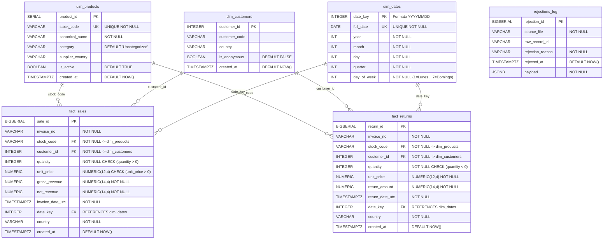

# DataMart Entity-Relationship Diagram (ERD) & Dimensional Catalog

## 1. Dimensional Architecture Overview

El repositorio analítico (**DataMart**) está diseñado bajo los principios de **Kimball Dimensional Modeling**, estructurado en un modelo **Star Schema (Esquema en Estrella)** optimizado para consultas analíticas de alto rendimiento en PostgreSQL 15+/16.

### Separación de Grano y Hechos
- **`fact_sales`**: Captura transacciones comerciales válidas de venta donde la cantidad (`quantity > 0`) y el precio unitario (`unit_price > 0`) son estrictamente positivos. Registra el ingreso bruto (`gross_revenue`) e ingreso neto (`net_revenue`).
- **`fact_returns`**: Captura transacciones de anulación, cancelación o devolución donde la cantidad es estrictamente negativa (`quantity < 0`). Registra el monto de devolución (`return_amount`).
- **`rejections_log`**: Tabla de auditoría y cuarentena para aislar registros anómalos o corruptos que violan reglas de integridad, preservando el payload original en formato `JSONB`.
- **Dimensiones Conformes**:
  - `dim_products`: Catálogo maestro de productos con código de inventario (`stock_code`), nombre canónico y categoría.
  - `dim_customers`: Padrón maestro de clientes con soporte para transacciones anónimas o invitados (`customer_id = -1`).
  - `dim_dates`: Calendario precalculado con jerarquías temporales (año, mes, día, trimestre, día de la semana) indexado por `date_key` (formato numérico `YYYYMMDD`).

---

## 2. Diagrama Entidad-Relación (Mermaid ERD)



---

## 3. Diccionario de Datos

### 3.1 `dim_products` (Dimensión de Catálogo de Productos)
| Columna | Tipo de Dato | Restricciones | Descripción |
| :--- | :--- | :--- | :--- |
| `product_id` | `SERIAL` | `PRIMARY KEY` | Clave sustituta autoincremental de la dimensión. |
| `stock_code` | `VARCHAR(50)` | `UNIQUE NOT NULL` | Clave de negocio (SKU / código de stock del catálogo). |
| `canonical_name` | `VARCHAR(255)` | `NOT NULL` | Nombre descriptivo normalizado del producto. |
| `category` | `VARCHAR(100)` | `DEFAULT 'Uncategorized'` | Clasificación funcional o departamental del ítem. |
| `supplier_country` | `VARCHAR(100)` | Nullable | País de origen o proveedor principal. |
| `is_active` | `BOOLEAN` | `DEFAULT TRUE` | Indicador de disponibilidad operativa en el catálogo. |
| `created_at` | `TIMESTAMPTZ` | `DEFAULT NOW()` | Fecha y hora UTC del registro de inserción. |

### 3.2 `dim_customers` (Dimensión de Clientes)
| Columna | Tipo de Dato | Restricciones | Descripción |
| :--- | :--- | :--- | :--- |
| `customer_id` | `INTEGER` | `PRIMARY KEY` | Clave identificadora del cliente. Contiene `-1` para compras anónimas. |
| `customer_code` | `VARCHAR(50)` | Nullable | Código textual o de fidelización del cliente. |
| `country` | `VARCHAR(100)` | Nullable | País de residencia registrado del cliente. |
| `is_anonymous` | `BOOLEAN` | `DEFAULT FALSE` | `TRUE` si la transacción no proporcionó identificación (`customer_id = -1`). |
| `created_at` | `TIMESTAMPTZ` | `DEFAULT NOW()` | Fecha y hora UTC de la creación del perfil. |

### 3.3 `dim_dates` (Dimensión Temporal / Calendario)
| Columna | Tipo de Dato | Restricciones | Descripción |
| :--- | :--- | :--- | :--- |
| `date_key` | `INTEGER` | `PRIMARY KEY` | Clave entera en formato numérico `YYYYMMDD` (ej. `20250425`). |
| `full_date` | `DATE` | `UNIQUE NOT NULL` | Fecha calendario estandarizada `YYYY-MM-DD`. |
| `year` | `INT` | `NOT NULL` | Año calendario (ej. `2025`). |
| `month` | `INT` | `NOT NULL` | Mes calendario del año (`1` a `12`). |
| `day` | `INT` | `NOT NULL` | Día del mes (`1` a `31`). |
| `quarter` | `INT` | `NOT NULL` | Trimestre del año (`1` a `4`). |
| `day_of_week` | `INT` | `NOT NULL` | Día de la semana ISO (`1` = Lunes, `7` = Domingo). |

### 3.4 `fact_sales` (Hechos de Ventas)
| Columna | Tipo de Dato | Restricciones | Descripción |
| :--- | :--- | :--- | :--- |
| `sale_id` | `BIGSERIAL` | `PRIMARY KEY` | Clave subrogada del registro de venta. |
| `invoice_no` | `VARCHAR(50)` | `NOT NULL` | Número de comprobante / factura de venta. |
| `stock_code` | `VARCHAR(50)` | `NOT NULL REFERENCES dim_products(stock_code)` | Clave foránea al catálogo de productos. |
| `customer_id` | `INTEGER` | `NOT NULL REFERENCES dim_customers(customer_id)` | Clave foránea al cliente (-1 si es anónimo). |
| `quantity` | `INTEGER` | `NOT NULL CHECK (quantity > 0)` | Cantidad de unidades vendidas (estrictamente positiva). |
| `unit_price` | `NUMERIC(12, 4)` | `NOT NULL CHECK (unit_price > 0)` | Precio unitario facturado. |
| `gross_revenue` | `NUMERIC(14, 4)` | `NOT NULL` | Monto bruto facturado (`quantity * unit_price`). |
| `net_revenue` | `NUMERIC(14, 4)` | `NOT NULL` | Monto neto facturado después de descuentos / deducciones. |
| `invoice_date_utc` | `TIMESTAMPTZ` | `NOT NULL` | Marca temporal UTC en la que ocurrió la venta. |
| `date_key` | `INTEGER` | `REFERENCES dim_dates(date_key)` | Clave foránea de enlace rápido con la dimensión calendario. |
| `country` | `VARCHAR(100)` | `NOT NULL` | País de destino / facturación de la transacción. |
| `created_at` | `TIMESTAMPTZ` | `DEFAULT NOW()` | Auditoría de inserción en el Data Warehouse. |

### 3.5 `fact_returns` (Hechos de Devoluciones y Cancelaciones)
| Columna | Tipo de Dato | Restricciones | Descripción |
| :--- | :--- | :--- | :--- |
| `return_id` | `BIGSERIAL` | `PRIMARY KEY` | Clave subrogada de la devolución. |
| `invoice_no` | `VARCHAR(50)` | `NOT NULL` | Número de comprobante de anulación (inicia con 'C'). |
| `stock_code` | `VARCHAR(50)` | `NOT NULL REFERENCES dim_products(stock_code)` | Clave foránea al catálogo de productos devueltos. |
| `customer_id` | `INTEGER` | `NOT NULL REFERENCES dim_customers(customer_id)` | Clave foránea al cliente que solicita el reembolso. |
| `quantity` | `INTEGER` | `NOT NULL CHECK (quantity < 0)` | Cantidad devuelta (estrictamente negativa). |
| `unit_price` | `NUMERIC(12, 4)` | `NOT NULL` | Precio unitario al que se calculó el reembolso. |
| `return_amount` | `NUMERIC(14, 4)` | `NOT NULL` | Monto total reembolsado (`ABS(quantity) * unit_price`). |
| `return_date_utc` | `TIMESTAMPTZ` | `NOT NULL` | Marca temporal UTC de la devolución. |
| `date_key` | `INTEGER` | `REFERENCES dim_dates(date_key)` | Clave foránea de enlace con dim_dates. |
| `country` | `VARCHAR(100)` | `NOT NULL` | País donde se originó la devolución. |
| `created_at` | `TIMESTAMPTZ` | `DEFAULT NOW()` | Auditoría de inserción en el Data Warehouse. |

### 3.6 `rejections_log` (Bitácora de Cuarentena y Calidad)
| Columna | Tipo de Dato | Restricciones | Descripción |
| :--- | :--- | :--- | :--- |
| `rejection_id` | `BIGSERIAL` | `PRIMARY KEY` | Identificador autoincremental del rechazo. |
| `source_file` | `VARCHAR(100)` | `NOT NULL` | Archivo o fuente de origen del registro procesado. |
| `raw_record_id` | `VARCHAR(100)` | Nullable | Identificador crudo de la fila o transacción original. |
| `rejection_reason` | `VARCHAR(255)` | `NOT NULL` | Motivo de negocio o validación que provocó el rechazo. |
| `rejected_at` | `TIMESTAMPTZ` | `DEFAULT NOW()` | Marca temporal del evento de descarte. |
| `payload` | `JSONB` | `NOT NULL` | Documento JSON íntegro con el registro original no procesable. |

---

## 4. Estrategia de Indexación y Optimización de Consultas

Para responder eficientemente a las 7 preguntas analíticas de negocio sin provocar escaneos secuenciales completos de tabla (*Full Table Scans*), se definen los siguientes índices:

| Índice | Tabla | Columnas | Caso de Uso / Pregunta de Negocio |
| :--- | :--- | :--- | :--- |
| `idx_fact_sales_invoice_date_utc` | `fact_sales` | `(invoice_date_utc)` | Filtrado por rangos de fechas UTC y cálculo de ventanas móviles. |
| `idx_fact_sales_stock_code` | `fact_sales` | `(stock_code)` | Agregación por producto (Q3: Top SKUs por facturación). |
| `idx_fact_sales_country` | `fact_sales` | `(country)` | Agrupación por país (Q1: Ventas mensuales por país). |
| `idx_fact_sales_customer_id` | `fact_sales` | `(customer_id)` | Análisis de clientes recurrentes vs anónimos y joins conformes. |
| `idx_fact_sales_date_key` | `fact_sales` | `(date_key)` | Join ultrarrápido con `dim_dates` para agregaciones por año, trimestre o mes. |
| `idx_fact_sales_invoice_no` | `fact_sales` | `(invoice_no)` | Consolidación a nivel factura y trazabilidad transaccional. |
| `idx_fact_returns_return_date_utc` | `fact_returns` | `(return_date_utc)` | Filtrado de devoluciones por periodo. |
| `idx_fact_returns_stock_code` | `fact_returns` | `(stock_code)` | Agregación de tasa de devoluciones por SKU (Q2 y Q3). |
| `idx_fact_returns_customer_id` | `fact_returns` | `(customer_id)` | Join de clientes con historial de devoluciones. |
| `idx_fact_returns_date_key` | `fact_returns` | `(date_key)` | Join con calendario en devoluciones. |
| `idx_fact_returns_country` | `fact_returns` | `(country)` | Análisis de devoluciones por geografía (Q1). |
| `idx_dim_products_category` | `dim_products` | `(category)` | Agrupación analítica de ingresos y devoluciones por categoría (Q2). |
| `idx_dim_dates_year_month` | `dim_dates` | `(year, month)` | Agrupaciones mensuales analíticas rápidas en dimensiones. |
| `idx_rejections_log_rejected_at` | `rejections_log` | `(rejected_at)` | Auditoría de tasas de rechazo en el tiempo (Q6). |
| `idx_rejections_log_reason` | `rejections_log` | `(rejection_reason)` | Agrupación de causas frecuentes de cuarentena (Q6). |
| `idx_rejections_log_payload_gin` | `rejections_log` | `USING GIN (payload)` | Búsqueda y filtrado en los atributos JSONB crudos. |

---

## 5. Idempotencia y Semillas Predeterminadas

1. **Cliente Invitado / Anónimo**:
   ```sql
   INSERT INTO dim_customers (customer_id, customer_code, country, is_anonymous)
   VALUES (-1, 'ANONYMOUS', 'UNKNOWN', TRUE)
   ON CONFLICT (customer_id) DO NOTHING;
   ```
   Garantiza que transacciones con `Customer ID` nulo o vacío no violen la integridad referencial y se asocien limpiamente al registro semilla `-1`.

2. **Dimensión de Calendario Precomputada**:
   Se precargan las fechas entre `2000-01-01` y `2035-12-31` con `ON CONFLICT (date_key) DO NOTHING`, asegurando resolución instantánea de atributos temporales sin coste de recálculo en la capa ETL.
